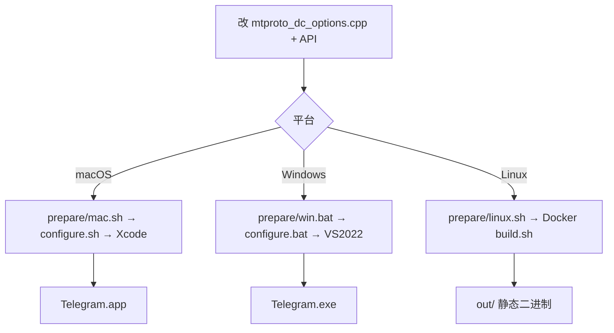

# 修改配置与打包

从改配置到产出 **可执行程序 / 安装包** 的完整流程（Teamgram 自建服场景）。各平台首次环境准备见下文「平台编译指引」。

---

## 一、要改哪些配置

Teamgram Desktop 需改两类配置：**连哪个服务端**、**应用身份与版本**。

### 1.1 服务端（必改）

| 文件 | 改什么 |
|------|--------|
| `Telegram/SourceFiles/mtproto/mtproto_dc_options.cpp` | `kBuiltInDcs` / `kBuiltInDcsTest` 中的 IP |
| （一般不改）同上 | MTProto 端口固定 **10443** |
| 同上 | `kPublicRSAKeys` / `kTestPublicRSAKeys` 须与后端 RSA 公钥一致 |

```cpp
const BuiltInDc kBuiltInDcs[] = {
    { 1, "127.0.0.1", 10443 },   // ← 改为你的服务器 IP
};
const BuiltInDc kBuiltInDcsTest[] = {
    { 1, "127.0.0.1", 10443 },   // ← 两处建议同步修改
};
```

改 C++ 后须 **重新 configure + 完整编译**。详见 [服务端对接配置.md](服务端对接配置.md)。

### 1.2 API 凭证（CMake 参数）

编译时通过 `configure.sh` / `configure.bat` 传入（不要长期把密钥写进公开仓库）：

| 参数 | 说明 | 仓库默认值 |
|------|------|------------|
| `TDESKTOP_API_ID` | [my.telegram.org](https://my.telegram.org) 申请的 api_id | `1025907`（见 `telegram_options.cmake`） |
| `TDESKTOP_API_HASH` | 同上 api_hash | 32 位十六进制 |
| `TDESKTOP_API_TEST` | 仅本地试验，**不可用于分发** | `OFF` |

须与 iOS / Android 自建端保持一致。

### 1.3 版本号

文件：`Telegram/build/version`

```
AppVersion         5013001
AppVersionStrMajor 5.13
AppVersionStrSmall 5.13.1
AppVersionStr      5.13.1
```

发包前按需递增 `AppVersion` 与显示版本字符串。

### 1.4 自建服推荐 CMake 选项

| 参数 | 说明 |
|------|------|
| `-D DESKTOP_APP_DISABLE_AUTOUPDATE=ON` | 关闭连官方 `teamgram.net/td` 的自动更新 |
| `-D DESKTOP_APP_DISABLE_CRASH_REPORTS=ON` | 关闭崩溃上报（可选） |

---

## 二、三种打包路径



---

## 三、路径 A：macOS 开发与打包

适合：本机开发、内测 `.app` 分发。

### 3.1 首次准备（一次性）

```bash
# 选工作目录，下文称 BuildPath
cd /path/to/BuildPath

brew install git automake cmake wget pkg-config gnu-tar ninja nasm meson
sudo xcode-select -s /Applications/Xcode.app/Contents/Developer

git clone --recursive <你的 teamgram-tdesktop 仓库> tdesktop
./tdesktop/Telegram/build/prepare/mac.sh   # 下载依赖，耗时较长
```

### 3.2 修改配置

```bash
vim tdesktop/Telegram/SourceFiles/mtproto/mtproto_dc_options.cpp
vim tdesktop/Telegram/build/version   # 可选
```

### 3.3 生成工程并编译

```bash
cd tdesktop/Telegram

./configure.sh \
  -D TDESKTOP_API_ID=你的API_ID \
  -D TDESKTOP_API_HASH=你的API_HASH \
  -D DESKTOP_APP_DISABLE_AUTOUPDATE=ON
```

用 Xcode 打开 `../out/Telegram.xcodeproj`，选 **Telegram** target，编译 **Debug** 或 **Release**。

### 3.4 产物

| 配置 | 常见路径 |
|------|----------|
| Debug | `out/Debug/Telegram.app` |
| Release | `out/Release/Telegram.app` |

内测分发可将 `Telegram.app` 打成 zip，或自行制作 DMG。

---

## 四、路径 B：Windows 开发与打包

适合：Windows 内测 / 企业分发 `.exe`。

### 4.1 首次准备

在 **x64 Native Tools Command Prompt for VS 2022** 中：

```bat
cd D:\TBuild
git clone --recursive <你的 teamgram-tdesktop 仓库> tdesktop
tdesktop\Telegram\build\prepare\win.bat
```

需已安装：Python 3.10+、Git、Visual Studio 2022（SDK 10.0.22000.0）。

### 4.2 编译

```bat
cd D:\TBuild\tdesktop\Telegram

configure.bat x64 ^
  -D TDESKTOP_API_ID=你的API_ID ^
  -D TDESKTOP_API_HASH=你的API_HASH ^
  -D DESKTOP_APP_DISABLE_AUTOUPDATE=ON
```

用 Visual Studio 2022 打开 `..\out\Telegram.sln` → 编译 **Telegram** 项目（Debug / Release）。

### 4.3 产物

| 配置 | 路径 |
|------|------|
| Debug | `out\Debug\Telegram.exe` |
| Release | `out\Release\Telegram.exe` |

Release 目录下通常含运行所需 DLL，整目录打包分发。

---

## 五、路径 C：Linux（Docker 静态构建）

适合：CI、服务器侧构建 Linux 可执行文件。

### 5.1 首次准备

```bash
cd /path/to/BuildPath
git clone --recursive <你的 teamgram-tdesktop 仓库> tdesktop
./tdesktop/Telegram/build/prepare/linux.sh
```

### 5.2 Release 构建

```bash
cd tdesktop

docker run --rm -it \
  -u $(id -u) \
  -v "$PWD:/usr/src/tdesktop" \
  tdesktop:centos_env \
  /usr/src/tdesktop/Telegram/build/docker/centos_env/build.sh \
  -D TDESKTOP_API_ID=你的API_ID \
  -D TDESKTOP_API_HASH=你的API_HASH \
  -D DESKTOP_APP_DISABLE_AUTOUPDATE=ON
```

Debug 构建加 `-e CONFIG=Debug`。

### 5.3 产物

构建结果在仓库根目录 **`out/`** 下（具体子目录随配置为 Debug / Release）。

---

## 六、打包前检查清单

| # | 检查项 |
|---|--------|
| 1 | `mtproto_dc_options.cpp` IP 可达（本机调试可用 `127.0.0.1`，局域网用内网 IP） |
| 2 | RSA 公钥与后端 `server_pkcs1.key` 匹配 |
| 3 | 后端已启动，`10443` / `11443` 防火墙放行 |
| 4 | `TDESKTOP_API_ID` / `TDESKTOP_API_HASH` 与各端一致 |
| 5 | 已执行 `prepare/*.sh|bat` 且 `configure` 成功 |
| 6 | 自建服建议开启 `DESKTOP_APP_DISABLE_AUTOUPDATE` |
| 7 | 应用名与图标未冒用官方 Telegram |

---

## 七、常见问题

| 现象 | 处理 |
|------|------|
| `configure` 报 API_ID 未设置 | 传入 `-D TDESKTOP_API_ID=... -D TDESKTOP_API_HASH=...` |
| 登录握手失败 | 检查 IP、端口、RSA 公钥；见 `teamgram.io/enterprise/docs/更换授权密钥.md` |
| 仍尝试连官方 DC | 确认 `mtproto_dc_options.cpp` 中 Teamgram patch 未被还原 |
| macOS 首次编译极慢 | `prepare/mac.sh` 需下载大量依赖，属正常 |
| 测试验证码 | 企业版测试环境常见 **12345** |
| 改 IP 后无效 | 删除 `out/` 后重新 `configure` 并全量编译 |

---

## 八、相关命令速查

```bash
# 1. 改服务端
vim Telegram/SourceFiles/mtproto/mtproto_dc_options.cpp

# 2. macOS
cd Telegram && ./configure.sh -D TDESKTOP_API_ID=xxx -D TDESKTOP_API_HASH=xxx \
  -D DESKTOP_APP_DISABLE_AUTOUPDATE=ON
# → Xcode 打开 ../out/Telegram.xcodeproj

# 3. Windows（VS 命令行）
configure.bat x64 -D TDESKTOP_API_ID=xxx -D TDESKTOP_API_HASH=xxx

# 4. Linux Docker
docker run --rm -it -u $(id -u) -v "$PWD:/usr/src/tdesktop" tdesktop:centos_env \
  /usr/src/tdesktop/Telegram/build/docker/centos_env/build.sh \
  -D TDESKTOP_API_ID=xxx -D TDESKTOP_API_HASH=xxx
```

---

## 九、平台编译指引（英文 upstream）

| 平台 | 文档 |
|------|------|
| macOS | [building-mac.md](building-mac.md) |
| Windows x64 | [building-win-x64.md](building-win-x64.md) |
| Linux Docker | [building-linux.md](building-linux.md) |
| Mac App Store | [building-mas.md](building-mas.md) |
| API 申请说明 | [api_credentials.md](api_credentials.md) |

---

相关：[Desktop客户端技术文档.md](Desktop客户端技术文档.md)、[服务端对接配置.md](服务端对接配置.md)、`teamgram/docs/企业版安装指南.md`、`teamgram-ios/docs/修改配置与打包.md`。
